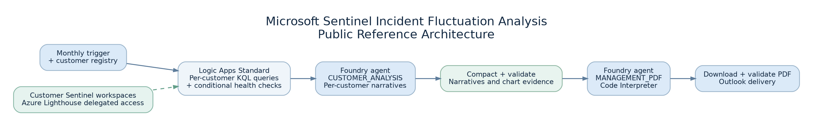
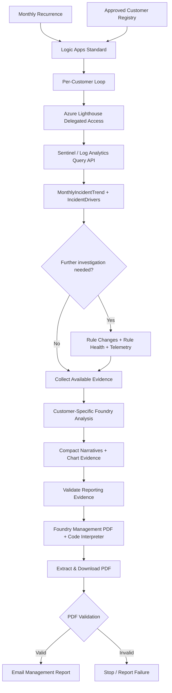

# Microsoft Sentinel Incident Fluctuation Analysis — MSSP Architecture Reference

> **Reference architecture and illustrative components, not a deployable copy of a production system.** All sample data is fictional. No customer data, credentials, tenant IDs, workspace IDs, or production KQL implementations are included.

This repository documents an Azure-native approach to **monthly, multi-customer Microsoft Sentinel incident fluctuation analysis**. The associated implementation evolved from a locally hosted Python proof of concept to an Azure Logic Apps Standard and Microsoft Foundry workflow.

A production-ready version has been **validated end to end with eight customer environments**; the design supports up to ten configured customer workspaces. This public repository demonstrates the architectural concepts and validation patterns, not the production tenant's deployment artifacts.

## Why this exists

Month-over-month incident counts require context. Decreasing counts might reflect fewer detections, changed analytics rules, telemetry interruptions, or genuine changes in activity. Stable totals can hide major rule-level composition shifts. This approach combines deterministic KQL evidence with bounded AI interpretation and human-readable reporting.

## Architecture



See the [detailed diagram](assets/architecture.png) and [editable diagram source and explanation](docs/architecture.md). Both illustrations use generic labels only.



## Major components

| Layer | Responsibility |
| --- | --- |
| Azure Lighthouse | Delegated access to customer Sentinel workspaces |
| Azure Logic Apps Standard | Schedule, orchestration, conditions, result collection, validations, email |
| Azure Monitor Logs Query API | Query approved per-workspace KQL evidence |
| Five approved KQL modules | Trend, rule drivers, rule changes, rule health, telemetry comparison |
| Microsoft Foundry | Two-mode agent for customer analysis and management report generation |
| Code Interpreter | Python-based chart and PDF assembly |
| Outlook connector | Deliver validated report to authorized recipients |

## Evidence contracts

The five tools are **MonthlyIncidentTrend**, **IncidentDrivers**, **AnalyticsRuleChanges**, **AnalyticsRuleHealth**, and **TelemetryVolumeComparison**. Their query implementations are intentionally not published here. See [query contracts](docs/query-contracts.md).

## What's in this repository?

- [`docs/architecture.md`](docs/architecture.md): system, data flow, and Mermaid diagram.
- [`assets/`](assets/): sanitized overview and detailed diagrams (PNG, SVG, editable Graphviz DOT).
- [`docs/workflow-guide.md`](docs/workflow-guide.md): implementation checklist and production considerations.
- [`docs/query-contracts.md`](docs/query-contracts.md): evidence shapes and validation semantics.
- [`docs/engineering-lessons.md`](docs/engineering-lessons.md): failures and what resolved them.
- [`docs/publication-checklist.md`](docs/publication-checklist.md): public-disclosure checklist.
- [`docs/publishing-guide.md`](docs/publishing-guide.md): step-by-step GitHub and Medium publication instructions.
- [`docs/medium-article.md`](docs/medium-article.md): publication-ready case study draft.
- [`prompts/agent-instructions-example.md`](prompts/agent-instructions-example.md): two-mode reference prompt.
- [`examples/customer-workspaces.example.json`](examples/customer-workspaces.example.json): fictional workspace registry.
- [`examples/management-evidence.example.json`](examples/management-evidence.example.json): synthetic compact reporting records.
- [`examples/validate-reporting-evidence.js`](examples/validate-reporting-evidence.js): illustrative Logic Apps Inline Code validation.
- [`scripts/validate_sample.py`](scripts/validate_sample.py): offline smoke test for synthetic evidence.
- [`scripts/public_release_check.py`](scripts/public_release_check.py): automatic checks for accidentally included private data or risky file types.
- [`.github/workflows/public-checks.yml`](.github/workflows/public-checks.yml): sample data validation and privacy checks on pushes and pull requests.

## Try the synthetic-data check

```bash
python3 scripts/validate_sample.py examples/management-evidence.example.json
```

This does not connect to Azure or generate production reports; it verifies the structure and count of the included fictional reporting records.

Run a publication safety scan before committing:

```bash
python3 scripts/public_release_check.py
```

This is a conservative automated check, not a guarantee against all PII, secrets, or confidential information. A human review is still necessary before publication.

## Deployment and authorization

Before any real deployment, implement your **own approved KQL queries**, authenticate with a properly scoped identity, configure Azure Lighthouse delegations, secure secrets outside source control, review request quotas, and establish run-history and report-delivery safeguards. Follow [`docs/workflow-guide.md`](docs/workflow-guide.md).

## Security and publication

Do **not** commit real incident logs, customer names, workspace identifiers, tenant or subscription IDs, secret values, actual HTTP authorization headers, email recipients, production run history, or unsanitized report PDFs. Organizational approval may be required before publishing internally developed prompts, workflows, or queries.

## License / reuse

No open-source license has been selected for this starter. Choose a license only after confirming ownership and organizational permission; a public repository without a license does **not** automatically authorize reuse.

## References

- [Azure Lighthouse and Microsoft Sentinel](https://learn.microsoft.com/en-us/azure/lighthouse/how-to/manage-sentinel-workspaces)
- [Azure Monitor Logs Query API](https://learn.microsoft.com/en-us/azure/azure-monitor/logs/api/overview)
- [Logic Apps Inline Code](https://learn.microsoft.com/en-us/azure/logic-apps/add-run-javascript?tabs=standard)
- [Foundry quota guidance](https://learn.microsoft.com/en-us/azure/foundry/openai/how-to/quota)
