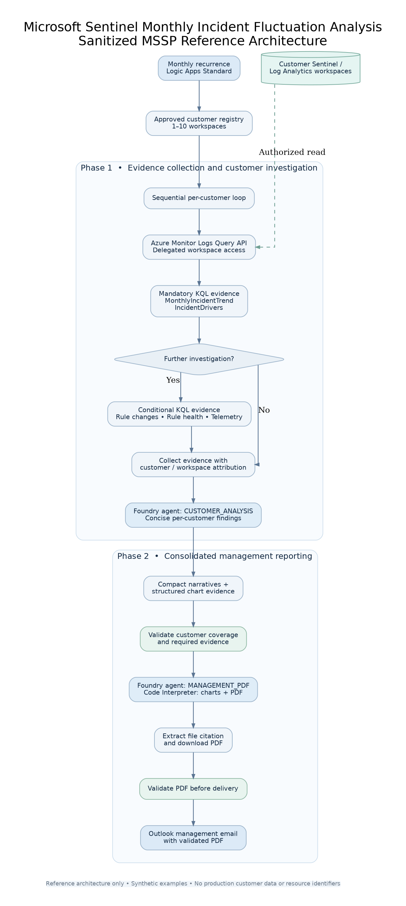
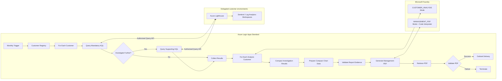

# Architecture — monthly multi-customer reporting

Editable public diagram sources: [`../assets/architecture.dot`](../assets/architecture.dot) and [`../assets/architecture-overview.dot`](../assets/architecture-overview.dot).

The production pattern uses **two distinct loops** in Logic Apps: one for workspace queries and one for independent customer-level AI analysis. The consolidated PDF is generated only after customer analyses and numerical evidence have been collected and validated.

## Trust boundaries

- Each query explicitly targets one configured customer workspace using delegated access. Customer data is not published to this repository.
- The workflow supplies existing query evidence to the Foundry agent; the agent does not execute the five approved KQL queries directly.
- `CUSTOMER_ANALYSIS` returns a compact customer-specific narrative. `MANAGEMENT_PDF` combines all validated narratives with separately prepared numeric chart evidence.
- PDF retrieval uses a real artifact/file reference from Code Interpreter. A PDF header check does not, by itself, prove report completeness.

## Operational considerations

- Keep shared Logic App array-variable updates sequential or otherwise implement race-safe aggregation.
- Validate the expected count, distinct workspaces, mandatory trend and driver records, and non-empty investigations before PDF generation.
- The PDF-generating model call can be much larger than an individual customer analysis. Use controlled payload size, bounded retry/backoff, quota monitoring and a clearly defined output contract.
- Review connection permissions, tenant delegation, data handling and confidentiality requirements before deployment.
