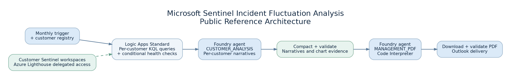

# From Python Scripts to Azure AI: Building an Automated Microsoft Sentinel Reporting Platform for MSSPs

*How Azure Logic Apps, Microsoft Foundry, and Azure Lighthouse helped turn manual monthly incident reviews into a multi-customer reporting workflow.*

**Suggested Medium tags:** Cybersecurity, Microsoft Sentinel, Azure, Security Operations, Automation

---

## The problem wasn't collecting incidents. It was explaining them.

In a managed security operations center (SOC), collecting incidents from Microsoft Sentinel is relatively straightforward. Explaining why incident volumes rise or fall across different customers is a much harder task.

A monthly report might tell us that incidents decreased by 40%. But what does that actually mean? Did suspicious activity decrease? Did an analytics rule change? Did a data connector stop sending logs? Or did several detection rules move in opposite directions while the overall total stayed relatively stable?

Those distinctions matter. An impressive-looking drop in incident volume is not necessarily good news if part of the detection pipeline has stopped working.

I set out to build a repeatable way to answer those questions across multiple Microsoft Sentinel environments. The initiative began as a locally hosted Python solution and evolved into an Azure-hosted orchestration and AI-assisted reporting workflow, validated end to end with eight customer environments and architected to support up to ten.

This article focuses on the engineering decisions, challenges, and lessons learned—not on customer-specific detection content.

## From a local proof of concept to cloud orchestration

The original implementation used Python to coordinate queries, interpret the outputs, and produce reporting artifacts. It proved that automated incident fluctuation analysis was possible, but a locally hosted script introduced practical dependencies: a machine had to run it, execution needed to be managed, and scaling the process to multiple customer environments required more operational coordination.

The next version moved orchestration to **Azure Logic Apps Standard**.

The Logic App handles the reporting schedule, customer registry, per-workspace queries, conditional investigation, result collection, calls to a Microsoft Foundry agent, PDF retrieval, validation, and email distribution. Python remains useful, but its role has shifted: rather than hosting the entire workflow, it is used through **Code Interpreter** to construct charts and the final PDF.

This separation turned out to be important. The workflow engine owns execution and control flow. KQL supplies authoritative evidence. The AI agent interprets that evidence and produces human-readable reporting.

## Architecture: five evidence sources, two AI modes

At a high level, the workflow follows these stages:

1. A monthly Logic App run loads the approved customer/workspace configuration.
2. Using appropriately delegated access, it queries each customer's Sentinel-connected Log Analytics workspace.
3. Two baseline KQL investigations establish the incident trend and the analytics rules responsible for changes.
4. A conditional investigation step decides whether supporting rule-change, rule-health, and telemetry-volume queries are needed.
5. Each customer's evidence is analyzed independently by the Foundry agent.
6. Completed investigations and a compact quantitative dataset are validated and combined.
7. A final Foundry request uses Code Interpreter to generate the management PDF, which is retrieved, checked, and emailed.

**Azure Lighthouse** makes the multi-customer access model practical for an MSSP. It supports delegated management of Sentinel resources across tenants without treating every customer's logs as though they belong in one central workspace. The actual authorization still depends on correctly configured tenant delegations and least-privilege role assignments.

The five approved KQL evidence components have separate responsibilities:

| Evidence component | Question it helps answer |
| --- | --- |
| `MonthlyIncidentTrend` | How did incident counts change between completed months? |
| `IncidentDrivers` | Which analytics rules contributed to the change? |
| `AnalyticsRuleChanges` | Were relevant rules modified, enabled, disabled, or created? |
| `AnalyticsRuleHealth` | Were there execution failures or detection-health concerns? |
| `TelemetryVolumeComparison` | Did log ingestion change in ways that could affect visibility? |

The key design principle is **evidence first, interpretation second**. The model does not invent KQL or modify analytics rules. It works from the query results passed by the orchestrator.

The same agent has two explicitly controlled operating modes.

**`CUSTOMER_ANALYSIS`** performs a focused, customer-specific investigation. Its output is deliberately concise—roughly 400–600 words—while preserving material findings, the important numbers, limitations, and recommended SOC actions.

**`MANAGEMENT_PDF`** consolidates the customer investigations with structured numerical evidence. It creates management-friendly explanations, charts, customer scorecards, and prioritized recommendations in a PDF. Code Interpreter is used for the actual Python chart and document generation.

Keeping these modes separate prevents the final PDF request from doing all the investigative work again.

## Why a percentage change isn't a conclusion

One of the most useful aspects of this approach is looking beyond the monthly total.

Imagine a customer with almost no net incident change. Several analytics rules may have increased significantly while others decreased. The overall count appears stable, but the underlying detection composition has shifted. A simple total would miss that.

Now consider a sharp decrease in incidents accompanied by lower ingestion from a security-relevant log source or failures in analytics rule execution. The decrease is observable; its cause may not be established. Reporting it as an improvement in security posture would be misleading.

The investigation therefore distinguishes between **confirmed observations**, **possible explanations**, and **unverified causes**. It also preserves classifications calculated by the approved KQL rather than redefining significance thresholds in the prompt.

This distinction is especially important in an MSSP setting, where an inaccurate explanation can affect customer expectations and operational priorities.

## The challenging part: making it reliable

The most interesting engineering lessons came from failures during development.

### 1. Cross-workspace querying requires precise identifiers

An early query failure came down to an incorrect workspace identifier. That reinforced the value of maintaining a validated customer registry and checking workspace references before running the monthly workflow.

### 2. Large AI requests can hit token-rate limits

The final reporting stage initially worked with a small number of customers but encountered HTTP 429 rate-limit errors as the workload grew. The issue wasn't solved by asking the model to produce shorter prose alone.

The useful optimizations were to shorten repetitive prompts, retain concise customer investigation narratives, remove redundant API-response metadata, prepare compact chart evidence, and use controlled pacing and retries. We also had to respect the model deployment's token-per-minute capacity.

Importantly, **reducing model input is not the same as reducing the required report content**. One overly aggressive optimization produced an incomplete, one-page document. That was a warning that completeness must be checked explicitly.

### 3. A technically valid PDF can still be the wrong report

In another test, the model produced a PDF explaining that the required evidence was missing. The file existed and was readable, but it was not a usable management deliverable.

This led to a dedicated reporting-evidence validation stage before PDF generation. It checks customer coverage and the presence of the expected trend and driver records. File validity and business-report completeness are different checks; both matter.

### 4. Inline JavaScript has workflow-specific constraints

An Inline Code validation action failed template validation when JavaScript referred to an action by a dynamic variable name. The workable approach was to use explicit action references and declare the corresponding dependencies.

This is a good example of why platform-aware implementation details matter even for seemingly simple validation code.

### 5. PDF layout needs engineering, not just prompting

A management report should not be a raw JSON dump with charts attached. We refined the reporting instructions toward readable incident comparisons, concise customer scorecards, plain-language executive summaries, and properly wrapped recommendation tables.

We also learned that a generated document needs visual validation: charts can have clipped labels, and long text can escape table cells. Explicit layout rules and reusable Python components are more dependable than repeatedly asking an AI model to “make it professional.”

## The production-ready workflow today

After those iterations, the solution successfully completed an end-to-end reporting run covering **eight customer environments**. The validated flow includes workspace-specific evidence retrieval, customer-level AI analysis, compact evidence preparation, report-generation validation, management PDF creation, file retrieval, PDF checks, and email delivery.

The design supports a customer registry of up to ten workspaces. That is a design target rather than a claim that every possible deployment configuration has been tested.

The benefits are practical: more consistent investigations, less repetitive monthly report preparation, better visibility into detection-rule and telemetry anomalies, and a common management reporting format. I have not included a percentage time-saving claim because that would require a measured before-and-after study.

## What I would improve next

The next areas of work are observability and repeatability: measure end-to-end execution time and token usage; track missing evidence and skipped investigations; ensure incomplete PDF content cannot be emailed as a success; and move toward a fixed, reusable report-generation template for more predictable page layouts.

A future version could also add clearer operational ownership for remediation actions, but the reporting workflow should remain distinct from actions that modify customer security controls.

## Sharing the architecture responsibly

I've prepared a sanitized GitHub reference project covering the architecture, evidence contracts, workflow stages, validation considerations, and development lessons. It intentionally excludes customer data, production credentials, tenant and workspace identifiers, proprietary KQL implementations, and unsanitized workflow exports.

[GitHub repository link — add after publishing]

## Final thoughts

For me, the biggest lesson from this initiative was that the AI model was only one component of the solution.

The hard parts were preserving trustworthy security evidence, isolating customer data, designing robust orchestration, handling rate limits, validating output completeness, and making the final report understandable to humans.

An AI-assisted SOC reporting platform becomes genuinely useful when those fundamentals are in place. The goal isn't to replace a security engineer's judgment; it's to make the monthly investigation process more consistent, explainable, and scalable.

---

### References

- [Manage Microsoft Sentinel workspaces at scale with Azure Lighthouse](https://learn.microsoft.com/en-us/azure/lighthouse/how-to/manage-sentinel-workspaces)
- [Azure Monitor Logs Query API overview](https://learn.microsoft.com/en-us/azure/azure-monitor/logs/api/overview)
- [Add and run inline JavaScript in Azure Logic Apps](https://learn.microsoft.com/en-us/azure/logic-apps/add-run-javascript?tabs=standard)
- [Manage Azure OpenAI quota in Microsoft Foundry](https://learn.microsoft.com/en-us/azure/foundry/openai/how-to/quota)
